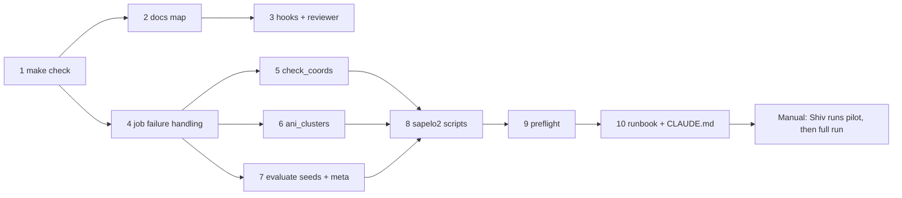

# TNF First Score Implementation Plan

> **For agentic workers:** REQUIRED SUB-SKILL: Use superpowers:subagent-driven-development (recommended) or superpowers:executing-plans to implement this plan task-by-task. Steps use checkbox (`- [ ]`) syntax for tracking.

**Goal:** Add the harness, the Sapelo2 job workflow, and the evaluation changes needed to compute the first KEGG_ko score of the TNF baseline on the lab's 1,000 genomes.

**Architecture:** Python stays in `tnf/` (library) and `scripts/` (CLIs). New CLIs (`check_coords.py`, `ani_clusters.py`, `sapelo2/preflight.py`) follow the existing argparse style. Sapelo2 orchestration is plain bash plus sbatch files under `scripts/sapelo2/`, with every path in `config.sh`. `make check` is the single local gate.

**Tech Stack:** Python 3, numpy, scipy, faiss-cpu, pyrodigal, pytest, ruff, bash, SLURM, skani.

**Spec:** `docs/superpowers/specs/2026-11-03-tnf-first-score-design.md`

## Global Constraints

- No em dash (U+2014) in any tracked text file or commit message.
- Lab data never committed: `*.fa`, `*.faa`, `*.emapper.*`, `*.tar*`, `*.npz` are blocked outside `data/genomes/` and `tests/`.
- Every reported number goes in `docs/results-log.md` with date, git commit, command, source JSON.
- KO vocabulary from training genomes only; k, T, threshold tuned on validation; test touched once per seed; frequency prior always reported beside retrieval.
- Split seeds for the first score: `0,1,2`. ANI cluster cut: distance `0.05` (95% ANI), average linkage via `tnf.evaluate.cluster_genomes`. skani pairs not reported count as ANI 0.
- Report field `cluster_source` is exactly `"ani95"` or `"tnf_fallback (circular)"`.
- Pilot size: 20 genomes, the first 20 by sorted file name.
- `make check` target runtime about 30 s.
- Commit messages end with the session's Co-Authored-By and Claude-Session lines.

## Review Focus

1. **skani sparse output columns differ by version.** `read_skani_sparse` must locate `Ref_file`, `Query_file`, `ANI` by header name, not position, and fail with a clear message naming the missing column. Test in Task 6.
2. **Prodigal `.faa` proteins end in `*`.** Protein length must exclude a trailing `*`, otherwise a qend equal to the true length still passes and an off-by-one hides. Test in Task 5.
3. **A genome with no seed orthologs or no `.faa`** must be reported (`n_missing_faa` / zero rows), not crash the whole check. Test in Task 5.
4. **Re-running after a partial failure** must skip finished genomes and rewrite `failures.tsv` fresh for that run, so stale failures do not linger. Test in Task 4.
5. **`--no-ani` and `--pilot` together** must still wire the dependency chain correctly (evaluate waits on featurize only). Test in Task 8.

---

### Task 1: `make check` with lint and style gates

**Files:**
- Create: `ruff.toml`, `Makefile`, `scripts/check_style.py`, `tests/test_style.py`
- Modify: files flagged by ruff (unused imports, sorted imports)

**Interfaces:**
- Produces: `scripts/check_style.py` CLI: `python scripts/check_style.py [PATH ...] [--text STRING]`; no paths means all `git ls-files`. Exit 1 and print `path:line` for each em dash; skips files that are not valid UTF-8. Function `find_em_dashes(paths: list[Path]) -> list[tuple[str, int]]`.
- Produces: `make check` = `lint test smoke style shellcheck` targets, in that order.

- [ ] **Step 1: Write failing tests** in `tests/test_style.py`:
  `test_flags_em_dash(tmp_path)`: file with `"a \u2014 b\n"` on line 2 gives `[(str(path), 2)]`.
  `test_ignores_binary(tmp_path)`: file with bytes `b"\xff\xfe\x14\x20"` gives `[]`.
  `test_clean_file(tmp_path)`: `"a, b\n"` gives `[]`.
- [ ] **Step 2: Run** `python -m pytest -q tests/test_style.py`. Expected: FAIL, module not found.
- [ ] **Step 3: Implement** `scripts/check_style.py`; import it in tests via `sys.path` insert of `scripts/` (same pattern `call_genes.py` uses).
- [ ] **Step 4: Run** the test file. Expected: PASS.
- [ ] **Step 5: Add `ruff.toml`**: `select = ["E9", "F"]`, `per-file-ignores = {"tnf/__init__.py" = ["F401"]}`. Run `ruff check .` and fix every remaining finding by hand (unused imports). Expected: `All checks passed!`
- [ ] **Step 6: Add `Makefile`** with targets: `lint` (`ruff check .`), `test` (`python -m pytest -q tests`), `smoke` (make_smoke_data, featurize `--window 5000 --stride 2500`, evaluate `--seeds 0` once Task 7 lands; until then without `--seeds`, all under `$(mktemp -d)`), `style` (`python scripts/check_style.py`), `shellcheck` (`bash -n` on every `scripts/**/*.sh` and `*.sbatch`), `check` depending on all five.
- [ ] **Step 7: Verify** `make check` passes. Then append a line with an em dash to a scratch `.md` file, `git add` it, run `make style`: Expected exit 1 naming that file. Remove the file.
- [ ] **Step 8: Commit** `Add make check: ruff, pytest, smoke run, em-dash and shell syntax gates`.

### Task 2: Docs map and record files

**Files:**
- Create: `AGENTS.md`, `docs/decisions.md`, `docs/results-log.md`, `docs/harness-log.md`
- Modify: `CLAUDE.md` (Design decisions section)

**Interfaces:**
- Produces: `docs/results-log.md` entry format, used by Task 10 and every later results entry:
  `## YYYY-MM-DD: <title>` then bullet lines `commit:`, `command:`, `source:`, `split:`, `kind:` (`project result` or `sanity check (public genomes)`), then a metrics table.

- [ ] **Step 1:** Move CLAUDE.md "Design decisions (and why)" verbatim into `docs/decisions.md`; leave in CLAUDE.md the heading plus one line pointing to it.
- [ ] **Step 2:** Write `AGENTS.md` (under 60 lines): repo map (from CLAUDE.md layout plus new files), the `make check` rule, the no-em-dash and no-lab-data rules, pointer to CLAUDE.md and `docs/`.
- [ ] **Step 3:** Write `docs/results-log.md` with the format above and one back-filled entry for the existing public-genome numbers, `kind: sanity check (public genomes)`, values copied from `results/window_taxonomy_results.json` and `results/locus_recovery.json` (open them; do not retype from CLAUDE.md).
- [ ] **Step 4:** Write `docs/harness-log.md` with a first dated entry: harness added; push blocked by missing GitHub App access on 2026-11-03.
- [ ] **Step 5: Verify** `make check` passes.
- [ ] **Step 6: Commit** `Add AGENTS.md and docs records; move design decisions out of CLAUDE.md`.

### Task 3: Claude Code hooks and reviewer agent

**Files:**
- Create: `.claude/settings.json`, `.claude/hooks/guard_commit.py`, `.claude/agents/reviewer.md`, `tests/test_guard_commit.py`

**Interfaces:**
- Consumes: `find_em_dashes` from Task 1.
- Produces: `guard_commit.py` reads hook JSON on stdin (`tool_input.command`). If the command does not contain `git commit`, exit 0. Otherwise block (print reason to stderr, exit 2) when: the command text contains an em dash; any staged path (`git diff --cached --name-only`) matches the lab-data patterns from Global Constraints outside `data/genomes/` and `tests/`; any staged text file contains an em dash. Pure helper `blocked_paths(paths: list[str]) -> list[str]`.

- [ ] **Step 1: Write failing tests**: `blocked_paths(["genomes/x.fa", "data/genomes/y.fna.gz", "tests/fixtures/a.faa", "eggnog/x/x.emapper.annotations", "cache/x.npz", "README.md"])` returns `["genomes/x.fa", "eggnog/x/x.emapper.annotations", "cache/x.npz"]`. And running the script with stdin `{"tool_input": {"command": "git commit -m \"a \u2014 b\""}}` exits 2; with `{"tool_input": {"command": "ls"}}` exits 0.
- [ ] **Step 2: Run** them. Expected: FAIL.
- [ ] **Step 3: Implement** `guard_commit.py`.
- [ ] **Step 4: Run** them. Expected: PASS.
- [ ] **Step 5: Write `.claude/settings.json`**: SessionStart hook `pip install -q -r requirements.txt`; PreToolUse hook, matcher `Bash`, command `python .claude/hooks/guard_commit.py`.
- [ ] **Step 6: Write `.claude/agents/reviewer.md`**: tools Read, Grep, Glob, Bash (read-only use). Checklist: KO vocabulary from train only; k/T/threshold from validation; test used once per seed; prior reported; `cluster_source` truthful; every number in prose traceable to a committed JSON; no em dashes; no lab data staged.
- [ ] **Step 7: Verify** `make check` passes.
- [ ] **Step 8: Commit** `Add commit guard hook, SessionStart install hook, reviewer agent`.

### Task 4: Per-genome failure handling in array jobs

**Files:**
- Create: `scripts/jobutil.py`, `tests/test_jobutil.py`
- Modify: `scripts/run_baseline.py` (`cmd_featurize`), `scripts/call_genes.py` (`main`)

**Interfaces:**
- Produces in `scripts/jobutil.py`:
  - `my_shard(items: list) -> list` using `SLURM_ARRAY_TASK_ID` (default 0) and `SLURM_ARRAY_TASK_COUNT` (default 1), `items[task::n]`.
  - `failures_path(out: Path) -> Path` = `out / f"failures.task{task}.tsv"` (one file per task, so concurrent tasks never write the same file; `evaluate` and `collect_results.sh` read `failures.task*.tsv`).
  - `class FailureLog` context manager: opens the task's file fresh (truncating), `record(gid: str, reason: str)` writes `gid<TAB>reason`, on exit removes the file if empty; `.count` attribute.
- Behavior: featurize and call_genes wrap each genome in `try/except Exception`, record and continue; after the loop `sys.exit(1)` if `count > 0`. The call_genes id-check failure is recorded with reason `ids: <missing>/<total> not reproduced`.

- [ ] **Step 1: Write failing tests**: `test_shards_cover_each_item_once(monkeypatch)`: for `n=7`, union of `my_shard(list(range(50)))` over tasks 0..6 equals `range(50)` with no duplicates. `test_failure_log_fresh_and_cleanup(tmp_path)`: pre-write a stale `failures.task0.tsv`; a `FailureLog` with no records leaves no file; one with `record("g1","boom")` leaves exactly one line `g1\tboom`. `test_featurize_skips_bad_genome(tmp_path)`: a genome dir with one valid smoke-sized FASTA (take 20 kb from `data/genomes/ecoli_K12.fna.gz`) and one file `bad.fa` containing `not a fasta`; running `run_baseline.py featurize` via subprocess exits 1, writes the good `.npz`, and the failures file names `bad`. Then rerun: the good genome is skipped (mtime unchanged).
- [ ] **Step 2: Run** them. Expected: FAIL.
- [ ] **Step 3: Implement** `jobutil.py`; switch both scripts to `my_shard` and `FailureLog`. If `featurize_genome` does not raise on `not a fasta` (it may yield zero sequences), raise `ValueError("no sequence")` when the total k-mer count is 0.
- [ ] **Step 4: Run** them, then `make check`. Expected: PASS.
- [ ] **Step 5: Commit** `Record per-genome failures in array jobs and keep going`.

### Task 5: Gene-coordinate check (`check_coords.py`)

**Files:**
- Create: `scripts/check_coords.py`, `tests/test_check_coords.py`

**Interfaces:**
- Consumes: `norm_id` from `run_baseline.py`.
- Produces:
  - `protein_lengths(faa: Path) -> dict[str, int]`: id = header up to first space, length excludes a trailing `*`.
  - `seed_qends(path: Path) -> dict[str, int]`: skip lines starting `#`; column 0 = query id, column 5 = qend (emapper 2.1.9 order: qseqid sseqid evalue bitscore qstart qend ...); keep the max qend per query.
  - `check_genome(lengths: dict[str,int], qends: dict[str,int]) -> dict` with keys `n_genes`, `n_ok`, `n_missing` (query absent from `.faa`), `n_too_long` (qend > length), `examples` (up to 5 failing ids).
  - CLI: `--faa DIR --annotations DIR --out DIR`. Writes `coords_check.tsv` (one row per genome: id, n_genes, n_ok, n_missing, n_too_long) and `coords_check.json` (`{"n_genomes", "n_genomes_all_ok", "gene_pass_rate", "n_missing_faa", "per_genome_failures": [...]}`). Always exits 0 (report only).

- [ ] **Step 1: Write failing tests**: `.faa` with `>c1_1 # 1 # 30 # 1 # ...\nMKV*\n>c1_2 ...\nMKVLA\n`; seed file `#qseqid...\nc1_1\tx\t1e-5\t50\t1\t3\t...\nc1_1\tx\t1e-5\t50\t1\t2\t...\nc1_2\tx\t1e-5\t50\t1\t6\t...\nc1_3\tx\t1e-5\t50\t1\t2\t...\n`. Assert `protein_lengths == {"c1_1": 3, "c1_2": 5}`; `seed_qends["c1_1"] == 3`; `check_genome` gives `n_genes=3, n_ok=1, n_missing=1, n_too_long=1`. A CLI test where one genome has no `.faa` gives `n_missing_faa == 1` and exit 0.
- [ ] **Step 2: Run** them. Expected: FAIL.
- [ ] **Step 3: Implement** `check_coords.py`.
- [ ] **Step 4: Run** them, then `make check`. Expected: PASS.
- [ ] **Step 5: Commit** `Add check_coords: verify re-called proteins against seed ortholog qend`.

### Task 6: ANI clusters from skani (`ani_clusters.py`)

**Files:**
- Create: `scripts/ani_clusters.py`, `tests/test_ani_clusters.py`

**Interfaces:**
- Consumes: `cluster_genomes(dist, threshold)` from `tnf.evaluate`; `norm_id` from `run_baseline.py`.
- Produces:
  - `read_skani_sparse(path: Path) -> list[tuple[str, str, float]]`: parse `skani triangle -E` TSV by header names `Ref_file`, `Query_file`, `ANI`; ids via `norm_id(Path(file))`. Missing column raises `ValueError` naming it.
  - `ani_distance(ids: list[str], pairs) -> np.ndarray`: `1 - ANI/100`, missing pairs `1.0`, diagonal `0`, symmetric.
  - `nearest_ani(ids, pairs) -> dict[str, float]`: best ANI to any other genome, `0.0` if none.
  - CLI: `--skani FILE --genomes DIR --out DIR`. Ids come from the genome dir (so genomes absent from skani output still appear, as singletons). Writes `clusters_ani95.tsv` (`id<TAB>cluster`) and `ani_summary.json`: `n_genomes`, `n_clusters`, `cluster_size_counts` (size to count), `nearest_ani_quantiles` at 0, 0.1, 0.25, 0.5, 0.75, 0.9, 1, `n_nearest_below_80`.

- [ ] **Step 1: Write failing tests**: sparse file with header `Ref_file\tQuery_file\tANI\tAlign_fraction_ref\tAlign_fraction_query\tRef_name\tQuery_name` and rows `g/a.fa g/b.fa 97.5`, `g/a.fa g/c.fa 85.0`; ids `[a,b,c,d]`. Assert clusters put a and b together, c and d alone (3 clusters); `nearest_ani == {"a": 97.5, "b": 97.5, "c": 85.0, "d": 0.0}`; distance `[0,3] == 1.0`. A header without `ANI` raises `ValueError` mentioning `ANI`.
- [ ] **Step 2: Run** them. Expected: FAIL.
- [ ] **Step 3: Implement** `ani_clusters.py`.
- [ ] **Step 4: Run** them, then `make check`. Expected: PASS.
- [ ] **Step 5: Commit** `Add ani_clusters: skani edges to 95% ANI clusters and summary`.

### Task 7: `evaluate --seeds` and run metadata

**Files:**
- Modify: `scripts/run_baseline.py` (`cmd_evaluate`, `main`)
- Create: `tests/test_evaluate_cli.py`
- Modify: `Makefile` smoke target to pass `--seeds 0`

**Interfaces:**
- Consumes: `failures.task*.tsv` naming from Task 4 (counted in `--cache` dir).
- Produces: `evaluate_split(seed, G, Y_sets, ids, groups, labels, cache, args) -> dict` (one seed: `split_sizes`, `n_kos`, `methods`, `ood_test_genomes`; the window block stays here, unchanged, active only with `--faa`). Report JSON shape:
  `{"meta": {"git_commit", "argv", "cluster_source", "n_matched", "n_unmatched", "n_failures", "seeds"}, "per_seed": {"0": {...}, ...}, "summary": {method: {metric: {"mean", "min", "max"}}}}` where metrics are the test `micro_f1`, `macro_f1`, `micro_precision`, `micro_recall`.
  New flag `--seeds` (comma list, default `"0"`); the old `--seed` is removed. `git_commit` from `git rev-parse HEAD` in the repo dir, `"unknown"` on failure. Console prints one line per method with mean and range of micro-F1 and macro-F1.

- [ ] **Step 1: Write failing test** `test_evaluate_two_seeds(tmp_path)` (module-scoped fixture builds smoke data with `tests/make_smoke_data.py` and featurizes genome-level only): run evaluate with `--seeds 0,1`. Assert `set(report["per_seed"]) == {"0","1"}`; `report["meta"]["cluster_source"] == "tnf_fallback (circular)"`; for both methods `summary[m]["micro_f1"]["min"] <= summary[m]["micro_f1"]["mean"] <= summary[m]["micro_f1"]["max"]`; `meta["n_failures"] == 0`. Second test: write a clusters TSV mapping every id to its own cluster and pass `--clusters`; assert `cluster_source == "ani95"`.
- [ ] **Step 2: Run** it. Expected: FAIL.
- [ ] **Step 3: Implement** the refactor; vocabulary, tuning and test stay inside `evaluate_split`, so nothing leaks across seeds.
- [ ] **Step 4: Run** it, then `make check`. Expected: PASS.
- [ ] **Step 5: Commit** `evaluate: multiple split seeds, summary, and run metadata`.

### Task 8: Sapelo2 job scripts

**Files:**
- Create: `scripts/sapelo2/config.sh`, `setup_env.sh`, `call_genes.sbatch`, `check_coords.sbatch`, `featurize.sbatch`, `skani.sbatch`, `evaluate.sbatch`, `submit_all.sh`, `collect_results.sh`; `tests/test_submit_all.py`
- Delete: `scripts/featurize_array.sbatch`

**Interfaces:**
- `config.sh` exports `GROUP_DIR` (placeholder `/work/CHANGE_ME`), `DATA="$GROUP_DIR/$USER/glm/family_1000_dataset_final_v2"`, `WORK_OUT="$GROUP_DIR/$USER/glm/prodigal"`, `SCRATCH="/scratch/$USER/glm"`, `ENV="$HOME/envs/tnf"`, `REPO` (dir of the repo, from the script location), `PY_MODULE` (placeholder `Python`), `MAIL=sp74395@uga.edu`. Every other script sources it. Honors `GLM_CONFIG` env var to source an alternative file (used by the test).
- sbatch resources: call_genes and featurize `--array=0-49 --cpus-per-task=1 --mem=8G --time=04:00:00`; skani `--cpus-per-task=16 --mem=32G --time=04:00:00`; check_coords and evaluate `--mem=16G --time=02:00:00`. Each sbatch reads `GENOMES`, `OUT` etc. from env passed by `submit_all.sh` (`--export=ALL,...`), not from hardcoded paths.
- `skani.sbatch`: `ls "$GENOMES"/*.fa > "$OUT/genomes.txt"`; `skani triangle -E -t "$SLURM_CPUS_PER_TASK" -l "$OUT/genomes.txt" -o "$OUT/skani_edges.tsv"`; then `python scripts/ani_clusters.py --skani ... --genomes "$GENOMES" --out "$OUT"`.
- `evaluate.sbatch` runs `run_baseline.py evaluate --cache "$CACHE" --annotations "$DATA/eggnog" --seeds 0,1,2 --out "$OUT"` plus `--clusters` when set. It never passes `--faa` (genome-level only for this run, per spec).
- `submit_all.sh [--pilot] [--no-ani] [--dry-run]`: uses `sbatch --parsable`. Pilot: `$SCRATCH/pilot/genomes` holds symlinks to the first 20 genomes by sorted name, all outputs under `$SCRATCH/pilot/`, arrays shrink to `--array=0-3`. Dependencies: check_coords `afterok:call_genes`; evaluate `afterok:featurize[:skani]`; evaluate gets `--clusters $ANI_OUT/clusters_ani95.tsv` unless `--no-ani`. Prints the job ids and the `squeue -u $USER` hint.
- `collect_results.sh RUN_DIR`: copies `baseline_report.json`, `ani_summary.json`, `clusters_ani95.tsv`, `coords_check.json`, `coords_check.tsv`, all `failures.task*.tsv`, and `sacct -j <ids> --format=JobID,JobName,State,Elapsed,MaxRSS` output into `results/lab/<YYYY-MM-DD>_<short commit>/`; refuses (exit 1) any file over 5 MB.

- [ ] **Step 1: Write failing test** `tests/test_submit_all.py`: put a fake `sbatch` on `PATH` (bash script appending its args to `$TMP/calls.log` and echoing an incrementing id), a temp `GLM_CONFIG` pointing at temp dirs with 25 empty `*.fa` files. Run `submit_all.sh --pilot`; parse calls. Assert 5 submissions; evaluate's args contain `--dependency=afterok:<featurize id>:<skani id>`; check_coords has `afterok:<call_genes id>`; `$SCRATCH/pilot/genomes` has exactly 20 symlinks. Second case `--pilot --no-ani`: 4 submissions, evaluate depends on featurize only and has no `--clusters`.
- [ ] **Step 2: Run** it. Expected: FAIL.
- [ ] **Step 3: Implement** the scripts; `setup_env.sh` tries, in order, `module load skani`, `conda install -y -c bioconda skani` into the env, then the skani GitHub release Linux binary into `$ENV/bin`; ends with `skani --version` and `python -m pytest -q tests`.
- [ ] **Step 4: Run** the test, then `make check` (includes `bash -n` on the new scripts). Expected: PASS.
- [ ] **Step 5: Commit** `Add Sapelo2 job scripts with a one-command chained submit and pilot mode`.

### Task 9: Preflight check

**Files:**
- Create: `scripts/sapelo2/preflight.py`, `tests/test_preflight.py`

**Interfaces:**
- Consumes: `norm_id`; config paths via env vars `DATA`, `WORK_OUT`, `SCRATCH` (set by `source config.sh`).
- Produces: `run_checks(data: Path, work_out: Path, scratch: Path, expect: int = 1000) -> list[tuple[str, bool, str]]` (name, ok, detail). Checks: genome count equals `expect`; annotation count equals `expect`; unmatched ids is 0; `logs/` exists; work_out and scratch writable (create then delete a temp file); `skani` on PATH; which of `/work` and `/project` exist; first non-comment line of one `.emapper.seed_orthologs` has at least 6 tab columns (prints it, so the qend column can be eyeballed). CLI prints a table and exits 1 if any check fails; `--expect N` for the pilot.

- [ ] **Step 1: Write failing test**: a temp dataset with 3 genomes, 3 annotation dirs (one with a seed file), `logs/`; `run_checks(..., expect=3)` passes every check except `skani` when skani is absent (assert by name); with one annotation removed, the count and unmatched checks fail.
- [ ] **Step 2: Run** it. Expected: FAIL.
- [ ] **Step 3: Implement** `preflight.py`.
- [ ] **Step 4: Run** it, then `make check`. Expected: PASS.
- [ ] **Step 5: Commit** `Add Sapelo2 preflight check`.

### Task 10: Runbook and CLAUDE.md refresh

**Files:**
- Create: `scripts/sapelo2/RUNBOOK.md`
- Modify: `CLAUDE.md` (Compute, Repo layout, Commands, Next steps, Timeline line), `README.md` (Running on the lab dataset)

- [ ] **Step 1:** Write `RUNBOOK.md` for a first-time SLURM user, starting with a Mermaid diagram of laptop, xfer node, `/work`, `/scratch`, and the job chain. Sections: 1 rsync the tarball to `xfer.gacrc.uga.edu` and extract into `$GROUP_DIR`; 2 clone the repo, edit `config.sh`; 3 `bash scripts/sapelo2/setup_env.sh`; 4 `python scripts/sapelo2/preflight.py`; 5 `bash scripts/sapelo2/submit_all.sh --pilot`, watch with `squeue`, read logs; 6 send Claude the pilot outputs; 7 full run; 8 `collect_results.sh`, commit `results/lab/`, push. Each step lists the exact command and what success looks like.
- [ ] **Step 2:** Update CLAUDE.md: Compute section points to the runbook; layout lists new files; Commands section replaces the old Sapelo2 lines with `submit_all.sh`; Next steps marks ANI moved into step 3; timeline notes spring 2027 model training on Sapelo2 per the CURO abstract.
- [ ] **Step 3: Verify** `make check` passes.
- [ ] **Step 4: Commit** `Add Sapelo2 runbook; refresh CLAUDE.md and README for the new workflow`.

## Manual steps after Task 10 (Shiv, on Sapelo2)

1. Stage data per RUNBOOK sections 1 to 4; paste the preflight table to Claude.
2. Pilot run; share `collect_results.sh` output from the pilot folder.
3. Full run; collect, commit, push `results/lab/`.
4. Claude adds the results-log entry from the committed JSON and updates CLAUDE.md "Results".
