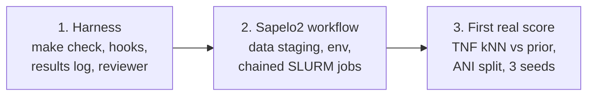
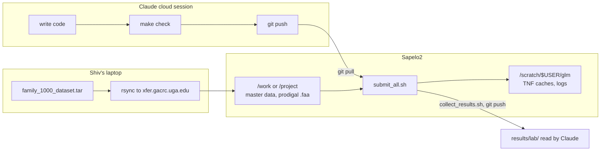
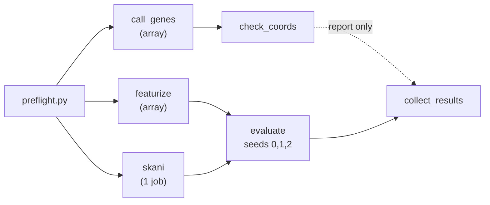
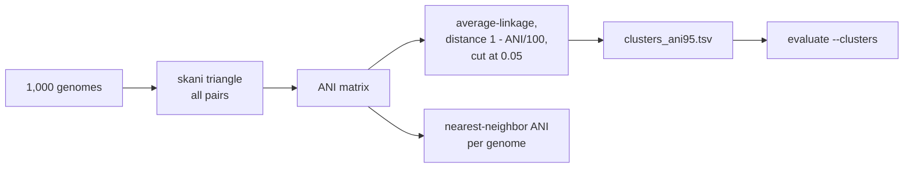

# TNF baseline: harness, Sapelo2 workflow, and first real score

Status: approved in discussion 2026-11-03 (sections 1 to 3), awaiting review of this written spec.
Visual companion: https://claude.ai/artifact/L3tD71X4pb4uhH39rfG6q7

## Goal

The TNF retrieval baseline is already written and unit tested, and it runs end to end on a
20-genome sample. It has never produced a KEGG_ko score on the lab's 1,000 genomes. This spec
covers the work needed to get that first score, computed on Sapelo2, with a split we can defend.
No new model is built here.

Out of scope: window-level traversal at scale, window size sweeps, calibration, hubness
mitigation, KO subsets, the windowed model, the GLM, and the hybrid. Each gets its own spec.

## Success criteria

1. `make check` passes on a clean checkout and fails on a planted em dash.
2. On Sapelo2, a 20-genome pilot and then the full 1,000-genome run complete through one
   command (`submit_all.sh`).
3. Known after the run: the qend pass rate, the number of ANI clusters at 95%, and the
   distribution of each genome's nearest-neighbor ANI.
4. Test micro-F1 and macro-F1 for TNF genome-kNN and the frequency prior, reported as mean and
   range over split seeds 0, 1, 2, with the split type stated.
5. Every reported number is in `docs/results-log.md`, copied from a committed JSON with its git
   commit and command. Retrieval is not described as working unless it beats the prior on all
   three seeds.

## Section 1: Harness

| Piece | Content |
|---|---|
| `AGENTS.md` | Short repo map for any coding agent. CLAUDE.md stays the main context file and links to it. |
| `docs/decisions.md` | The "Design decisions (and why)" section moved out of CLAUDE.md; CLAUDE.md keeps a one-line pointer. |
| `docs/results-log.md` | Dated, append-only. Each entry: date, git commit, exact command, source JSON path, numbers. Public-genome results are marked as sanity checks. |
| `docs/harness-log.md` | What tripped us up and what changed in the harness. |
| `docs/superpowers/specs/`, `docs/plans/` | Specs and execution plans. |
| `Makefile` | `make check` = `ruff check` + `pytest -q tests` + smoke pipeline in a temp dir + em-dash check + `bash -n` on shell scripts. Target: about 30 s. |
| `.claude/settings.json` | SessionStart hook: `pip install -r requirements.txt`. PreToolUse hook on `git commit`: block staged em dashes and lab data (`*.fa`, `*.emapper.*`, `*.tar*`, `*.faa` outside `data/genomes/` and `tests/`). |
| `.claude/agents/reviewer.md` | Reviews diffs for leakage (KO vocabulary from train only; k, T, threshold tuned on val; test touched once), number provenance, and house style. |

Not included: GitHub Actions CI, a scheduled gardener, coverage gates.

## Section 2: Sapelo2 workflow

### Where code and data live

Lab genomes and annotations never go to GitHub. Only small outputs (JSON, figures, job
summaries) come back.

### Files (all in `scripts/sapelo2/`)

| File | Purpose |
|---|---|
| `config.sh` | The only file with paths: `DATA` (master copy), `WORK_OUT` (prodigal output), `SCRATCH` (caches, logs), `ENV` (venv), `GROUP_DIR`. |
| `RUNBOOK.md` | Step by step for someone new to SLURM: rsync, extract, setup, preflight, pilot, full run, collect results. |
| `setup_env.sh` | Load the Python module, create the venv, `pip install -r requirements.txt`, install skani (bioconda via conda, or a prebuilt binary if conda is unavailable), run `pytest`. |
| `preflight.py` | Login node, seconds. Checks: 1,000 genomes, 1,000 matching annotations, `logs/` present, every config path exists and is writable, skani on PATH. Reports which of `/work` and `/project` exist. Exits non-zero on any problem. |
| `call_genes.sbatch` | Array job over `scripts/call_genes.py`. |
| `check_coords.sbatch` | Single job over `scripts/check_coords.py` (Section 3). |
| `featurize.sbatch` | Array job over `run_baseline.py featurize`; replaces `scripts/featurize_array.sbatch`. |
| `skani.sbatch` | Single multi-core job: `skani triangle` on all genomes, then cluster at 95% ANI. |
| `evaluate.sbatch` | Single job, more memory, loops over seeds 0, 1, 2. |
| `submit_all.sh` | Submits the chain with `--dependency=afterok`. `--pilot` builds a 20-genome symlinked subset and runs the same chain on it. |
| `collect_results.sh` | Copies report JSON, figures, and a `sacct` summary into `results/lab/<date>_<commit>/`. |

### Job chain

`evaluate` depends on `featurize` and `skani`. `call_genes` and `check_coords` run in the same
submission, but genome-level evaluation does not wait on them: the qend result is reported but
does not block genome-level numbers.

### Failure handling

- Reruns are safe: existing outputs are skipped unless `--overwrite`.
- A genome that fails is logged to `failures.tsv` in its output folder; the task continues, then
  exits non-zero, so `afterok` stops the chain before `evaluate` sees incomplete data.
- If skani cannot be installed, `submit_all.sh --no-ani` runs the TNF-distance fallback and the
  report records `"cluster_source": "tnf_fallback (circular)"`.

### Open facts to confirm on first login (the preflight prints them)

- The lab group directory name under `/work` and `/project`, and which one compute nodes mount.
- The Python module name (`module spider Python`).
- Whether conda (`module spider Miniforge` or similar) is available for skani.

## Section 3: First real score

### Gene-coordinate check (`scripts/check_coords.py`)

The windows need gene positions, and we re-created them with pyrodigal because the tarball has
no Prodigal files. Ids already match 100% on the sample. This check confirms the proteins are
the same length too: for every annotated gene, `qend` in `<id>.emapper.seed_orthologs` (amino
acid coordinates) must be no greater than the re-called protein length. Output: per-genome pass
rate and an overall rate in `coords_check.tsv` and `coords_check.json`. Any failure blocks future
window-level work, not genome-level numbers.

If Ashutosh's original Prodigal files are still on Sapelo2, they replace the re-called ones and
this check becomes a cross-check.

### ANI clusters (skani)

Close relatives on both sides of a split are leakage: kNN finds the twin. Clusters at 95% ANI
(about the species boundary) keep relatives together.

`scripts/ani_clusters.py` turns skani output into `clusters_ani95.tsv` (reusing
`tnf.evaluate.cluster_genomes`) and `ani_summary.json` (cluster count, cluster size histogram,
nearest-neighbor ANI quantiles). Pairs skani does not report (below its ~80% detection floor) are
treated as ANI 0. The summary is our evidence for the "family_1000" question: if almost every
genome's nearest neighbor is below 80% ANI, the set is close to one genome per family.

### Evaluate changes (`scripts/run_baseline.py evaluate`)

- `--seeds 0,1,2`: run the split, tuning, and test once per seed; the report keeps each seed and
  adds mean and range per method and metric.
- Run metadata in the JSON: git commit, full argv, `cluster_source` (`ani95` or
  `tnf_fallback (circular)`), counts of matched and unmatched genomes, number of failures read
  from `failures.tsv`.
- Genome-level only for this run: `--faa` is not passed. Window traversal at 5 kb means roughly
  300k query windows against 700k references with exact search, which belongs to the window spec.
- Unchanged: KO vocabulary from train only; k, T, and threshold tuned on validation; test used once
  per seed; frequency prior reported beside retrieval; `ood_test_genomes` still written.

### Recording results

`collect_results.sh` brings the folder back; a results-log entry is added with numbers copied
from the committed JSON. The entry states the split type and that this is genome-level only.

## Testing

| What | How |
|---|---|
| Array sharding | pytest: fake `SLURM_ARRAY_TASK_ID`/`COUNT` for 7 tasks over the smoke genomes; every genome processed exactly once. |
| `check_coords.py` | pytest on synthetic `.faa` + `.seed_orthologs`: one passing and one failing gene. |
| `ani_clusters.py` | pytest on a small hand-written skani output: expected clusters, missing pairs treated as 0. |
| `evaluate --seeds` | Smoke pipeline with two seeds produces per-seed entries, a summary, and metadata. |
| Shell scripts | `bash -n` in `make check`. |
| Real cluster | `submit_all.sh --pilot` first; Shiv shares the summary and logs before the full run. |

## Build order

1. Harness (Section 1), so `make check` guards everything after it.
2. Code changes with tests: `check_coords.py`, `ani_clusters.py`, `evaluate --seeds` and metadata.
3. `scripts/sapelo2/` files and `RUNBOOK.md`.
4. Shiv: stage data, setup, preflight, pilot. Then full run.
5. Collect results, results-log entry, update CLAUDE.md "Results" and "Next steps".
