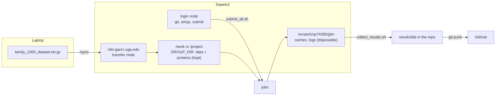
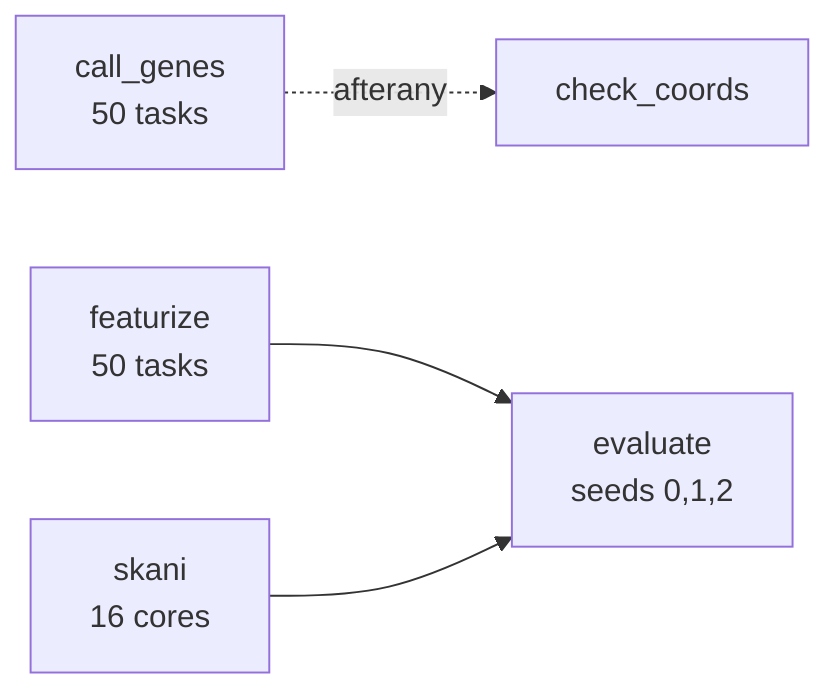

# Sapelo2 runbook: first TNF score on the 1,000 lab genomes

For someone who has logged in to Sapelo2 before but has not run SLURM jobs. Each step gives the
command and what success looks like. Commands assume your MyID is `sp74395` (from your UGA
email); replace it if not.



What runs, and what waits for what:



## 0. Words you will see

- **Login node**: where you land after `ssh`. Fine for git, editing, and submitting; never run
  heavy work here.
- **Transfer (xfer) node**: for moving files in and out.
- **Job**: a script SLURM runs for you on a compute node. **Array job**: the same script run as
  many tasks (here 50), each handling every 50th genome.
- `squeue -u $USER` lists your waiting (`PD`) and running (`R`) jobs. `sacct -j <id>` shows
  finished ones (`COMPLETED` or `FAILED`).

## 1. Copy the data to Sapelo2 (from your laptop)

First find your lab's group directory (on Sapelo2: `ls /work /project`, or ask Dr. Dutta).
Below it is written `GROUP_DIR`.

```bash
# on your laptop, in the folder holding the tarball (.tar.gz, or .tar if Safari unpacked it)
rsync -avP family_1000_dataset.tar.gz sp74395@xfer.gacrc.uga.edu:GROUP_DIR/sp74395/glm/
```

You will get a password and Duo prompt. Success: the transfer reaches 100%.

```bash
# then on the xfer node (ssh sp74395@xfer.gacrc.uga.edu)
cd GROUP_DIR/sp74395/glm
tar -xzf family_1000_dataset.tar.gz      # use tar -xf for a plain .tar
ls family_1000_dataset_final_v2          # expect: eggnog  genomes  logs
ls family_1000_dataset_final_v2/genomes | wc -l   # expect: 1000
```

## 2. Get the code and set the two paths

```bash
ssh sp74395@sapelo2.gacrc.uga.edu
git clone https://github.com/ShivPanndey/glm-research.git ~/glm-research
cd ~/glm-research
git checkout claude/practical-pasteur-dqlixc   # until this branch is merged
module spider Python                            # note a full module name, e.g. Python/3.x.y-...
nano scripts/sapelo2/config.sh                  # set GROUP_DIR and PY_MODULE, save
```

## 3. One-time environment setup (about 5 to 10 minutes)

```bash
bash scripts/sapelo2/setup_env.sh
```

Success: it prints `python: ...`, a `skani: ...` line, the test suite passing, and
`setup done`. If it says `skani: NOT installed`, try `module spider skani` and tell Claude what
it shows; you can still run everything with `--no-ani` (the report then labels the split as
circular).

## 4. Preflight (seconds)

```bash
source scripts/sapelo2/config.sh
source "$VENV/bin/activate"
python scripts/sapelo2/preflight.py
```

Success: every line says `PASS`. Paste the whole output to Claude either way; the
`seed_orthologs format` line lets us confirm the qend column.

## 5. Pilot run on 20 genomes

```bash
bash scripts/sapelo2/submit_all.sh --pilot
squeue -u $USER          # repeat until your jobs are gone (minutes to an hour, queue dependent)
ls /scratch/sp74395/glm/pilot/logs/
```

Success: `sacct -j <ids from job_ids.txt>` shows every job `COMPLETED`, and
`/scratch/sp74395/glm/pilot/results/baseline_report.json` exists. If a job failed, its log in
`pilot/logs/` says why.

## 6. Send the pilot to Claude

```bash
bash scripts/sapelo2/collect_results.sh /scratch/sp74395/glm/pilot
git add results/lab && git commit -m "Add pilot results" && git push
```

Pilot numbers on 20 genomes are a plumbing check, not results.

## 7. Full run on 1,000 genomes

Only after Claude has looked at the pilot.

```bash
bash scripts/sapelo2/submit_all.sh
```

Expect a few hours depending on the queue. SLURM emails you when each job ends or fails.

## 8. Bring the results back

```bash
bash scripts/sapelo2/collect_results.sh /scratch/sp74395/glm/run
git add results/lab && git commit -m "Add first full-run results" && git push
```

Then tell Claude. It adds the numbers to `docs/results-log.md` from the committed JSON.

## If something goes wrong

### One genome failed

featurize exits with an error if even one genome fails, and SLURM then cancels evaluate (it
only runs when everything before it succeeded). To recover:

1. Read the reason: `cat /scratch/sp74395/glm/run/tnf_cache/failures.task*.tsv`.
2. If it is fixable (for example a time limit), rerun the whole command,
   `bash scripts/sapelo2/submit_all.sh`. Finished genomes are skipped, so only the failed ones
   are redone. Always resubmit the whole command, never a single array index.
3. If the genome is genuinely broken, tell Claude. Evaluating without it is a decision we record
   (`n_failures` in the report), not something to do silently.

| Symptom | Likely cause | Fix |
|---|---|---|
| `module: command not found` in a job log | job started without modules | tell Claude; add `source /etc/profile` to the sbatch file |
| `skani not found` in the skani log | step 3 could not install it | rerun with `--no-ani`, ask Claude |
| featurize or call_genes `FAILED` | one or more genomes failed | read `failures.task*.tsv` in that output folder, then see "One genome failed" below |
| evaluate shows `CANCELLED` | featurize or skani failed, so SLURM cancels evaluate | `sacct` shows which one failed |
| `Disk quota exceeded` | scratch or group quota | `du -sh /scratch/sp74395/glm/*`, delete old `pilot/` |
